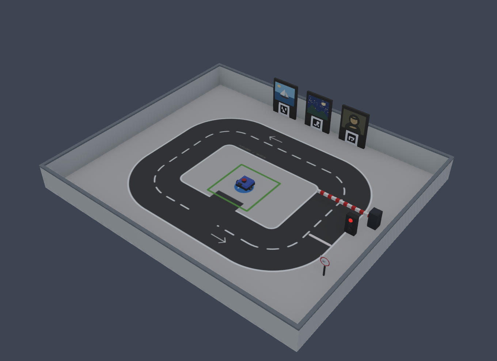

# TurtleBro: тренажёр Webots

Эта ветка содержит карту по мотивам фотографии соревнований и **ту же копию
`main.py`, что и ветка [`main`](https://github.com/HungryArthur/ros_champ/tree/main)**.
Основная ветка предназначена для настоящего TurtleBro с ROS; здесь импорт
`from turtlebro_py import TurtleBro` подключает совместимый адаптер Webots.



Сценарий: парковка → светофор → шлагбаум → картина с нужным ArUco → парковка.
Это маршрут по заранее известным точкам, с одометрией; разметка камерой
не отслеживается. Для другого поля нужно изменить размеры и координаты.

## Windows

Установите [Python 3.12](https://www.python.org/downloads/windows/), Git и
[Webots R2025a](https://github.com/cyberbotics/webots/releases/tag/R2025a).
ROS и WSL на компьютере для тренировки не требуются.

```powershell
git clone --branch webots-training https://github.com/HungryArthur/ros_champ.git ros_champ_webots
cd ros_champ_webots
py -3.12 -m venv .venv
.\.venv\Scripts\python.exe -m pip install -r requirements.txt
.\.venv\Scripts\python.exe sim.py --reset
.\.venv\Scripts\python.exe main.py
```

Если Webots ещё не установлен, его официальный установщик можно запустить так:

```powershell
Invoke-WebRequest -Uri "https://github.com/cyberbotics/webots/releases/download/R2025a/webots-R2025a_setup.exe" -OutFile "$env:TEMP\webots-R2025a_setup.exe"
Start-Process -FilePath "$env:TEMP\webots-R2025a_setup.exe" -Wait
```

## Linux

Пример для Ubuntu/Debian x86_64 с рабочим столом:

```bash
sudo apt update
sudo apt install -y git python3 python3-venv python3-pip wget
wget -O /tmp/webots_2025a_amd64.deb https://github.com/cyberbotics/webots/releases/download/R2025a/webots_2025a_amd64.deb
sudo apt install /tmp/webots_2025a_amd64.deb
git clone --branch webots-training https://github.com/HungryArthur/ros_champ.git ros_champ_webots
cd ros_champ_webots
python3 -m venv .venv
./.venv/bin/python -m pip install -r requirements.txt
./.venv/bin/python sim.py --reset
./.venv/bin/python main.py
```

Если Webots уже установлен, пропустите его установку. Для других дистрибутивов
доступен архив `.tar.bz2` в официальном выпуске. Используйте `.deb` или архив:
Snap ограничивает запуск контроллера через пользовательское окружение Python.

## Каждый следующий заезд

Меняйте `TARGET = 3` в `main.py`, чтобы выбрать картину 1, 2 или 3.
Перед повторным запуском **явно сбрасывайте мир**:

Windows:

```powershell
.\.venv\Scripts\python.exe sim.py --reset
.\.venv\Scripts\python.exe main.py
```

Linux:

```bash
./.venv/bin/python sim.py --reset
./.venv/bin/python main.py
```

`main.py` не вызывает сброс: такой команды нет в оригинальной библиотеке робота.
Светофор меняется на зелёный после остановки рядом примерно на 5 секунд;
шлагбаум начинает подниматься после отдельного ожидания примерно 3 секунды.
Сигнал и ArUco читаются камерой, свободный путь проверяется лидаром.
Словарь маркеров — `DICT_4X4_50`.

`sim.py --stop` закрывает учебный мир. Сам мир находится в
`webots/worlds/turtlebro.wbt`; все текстуры локальные. Если Webots установлен
нестандартно, задайте `WEBOTS_HOME` до запуска: `$env:WEBOTS_HOME = "D:\Webots"`
в PowerShell или `export WEBOTS_HOME="$HOME/webots"` в Linux.
Лог контроллера: `.webots_state/webots.log`.

## Перенести свой скрипт из основной ветки

Сохраните изменения и обновите ссылки на ветки. В этой ветке команда
перенесёт последнюю версию файла с GitHub:

```bash
git fetch origin
git restore --source origin/main -- main.py
```

Меняется только файл, сама ветка остаётся `webots-training`.
Для настоящего робота скопируйте этот же `main.py`; подключение и установка
библиотеки производителя описаны в README основной ветки.

Адаптер повторяет используемые скриптом методы, включая остановку через
`tb.vel_pub.publish()`. `pose` в Webots берётся из точного положения модели;
на роботе это одометрия с погрешностью. Физические размеры, трение и камера
приближённые, поэтому физический робот требует отдельной калибровки.

Служебные файлы `simulation/` и `webots/` нужны только тренажёру.
`tools/build_course.py` пересоздаёт карту и её текстуры.
Тесты без запуска Webots: `python -m unittest discover -s tests -v`.
