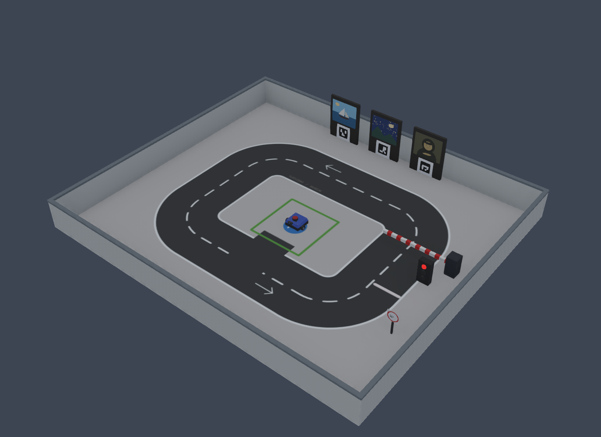

# TurtleBro: робот-экскурсовод в Webots

Учебный полигон для управления TurtleBro обычным Python-скриптом на Windows и Linux.
Запускайте `main.py` — Webots откроет полигон, а робот выполнит экскурсию:
парковка → правая полоса → светофор → шлагбаум → нужная картина → парковка.
Каждый заезд автоматически начинается со сброса мира.



Мир: [webots/worlds/turtlebro.wbt](webots/worlds/turtlebro.wbt).
Модель: [webots/protos/TurtleBro.proto](webots/protos/TurtleBro.proto).
Полигон размером **4.4 × 3.8 м** собран по мотивам фотографии соревнований:
кольцевая дорога с закруглениями, белая разметка, зелёная парковка, борта,
действующие светофор и шлагбаум, три картины с ArUco-маркерами.
Размеры выбраны для тренировки; это не точная копия неизвестного регламента.
У робота два ведущих колеса,
задняя опора, лидар, камера, энкодеры, GPS, датчик ориентации, динамик и RGB-индикатор.

## Установка на Windows

Нужны [Python 3.12, 64 бит](https://www.python.org/downloads/windows/),
[Git](https://git-scm.com/downloads/win) и Webots R2025a.
При установке Python оставьте включённым Python Launcher (`py`).

Если Webots ещё не установлен, скачайте и запустите официальный установщик
из PowerShell:

```powershell
Invoke-WebRequest -Uri "https://github.com/cyberbotics/webots/releases/download/R2025a/webots-R2025a_setup.exe" -OutFile "$env:TEMP\webots-R2025a_setup.exe"
Start-Process -FilePath "$env:TEMP\webots-R2025a_setup.exe" -Wait
```

Скачайте проект и установите его Python-зависимости:

```powershell
git clone https://github.com/HungryArthur/ros_champ.git
cd ros_champ
py -3.12 -m venv .venv
.\.venv\Scripts\python.exe -m pip install -r requirements.txt
.\.venv\Scripts\python.exe main.py
```

Если папка проекта уже скачана, откройте терминал в ней и начинайте с создания
`.venv`. При готовом окружении для каждого запуска достаточно последней команды.
Активация окружения и изменение политики PowerShell не требуются.

## Установка на Linux

Следующие команды предназначены для Ubuntu/Debian на x86_64 с рабочим столом
и Python 3.10 или новее. Установите Git, Python и официальный пакет Webots:

```bash
sudo apt update
sudo apt install -y git python3 python3-venv python3-pip wget
wget -O /tmp/webots_2025a_amd64.deb https://github.com/cyberbotics/webots/releases/download/R2025a/webots_2025a_amd64.deb
sudo apt install /tmp/webots_2025a_amd64.deb
```

Скачайте проект и установите Python-зависимости:

```bash
git clone https://github.com/HungryArthur/ros_champ.git
cd ros_champ
python3 -m venv .venv
./.venv/bin/python -m pip install -r requirements.txt
./.venv/bin/python main.py
```

Если Webots уже установлен, его повторную установку пропустите. Для других
дистрибутивов используйте архив `.tar.bz2` из
[официального выпуска](https://github.com/cyberbotics/webots/releases/tag/R2025a)
и [инструкцию Cyberbotics](https://github.com/cyberbotics/webots/blob/R2025a/docs/guide/installation-procedure.md).
Для этого проекта выбирайте `.deb` или `.tar.bz2`: Snap ограничивает запуск
контроллера с Python из нашего `.venv`.

## Зависимости и библиотеки

`requirements.txt` содержит NumPy и OpenCV для камеры, дорожной разметки,
цветов светофора и ArUco. Используется словарь **DICT_4X4_50**, номера картин 1–3.
API распознавания: [официальная документация OpenCV](https://docs.opencv.org/4.x/d5/dae/tutorial_aruco_detection.html).
Зависимости устанавливаются командой `python -m pip install -r requirements.txt`
через Python созданного окружения, как показано выше. Сам Webots ставится отдельно;
его Python-модуль `controller` входит в установку симулятора.

`turtlebro_py.py`, `simulation/` и `webots/controllers/` — код этого проекта,
который связывает привычные команды TurtleBro с Webots. Их нужно хранить в репозитории.
Копия библиотеки производителя `voltbro/turtlebro_extra` в проект не включена;
для симуляции она не требуется. На настоящий робот её устанавливают отдельно
по инструкции ниже. ROS, WSL и Gazebo для симуляции не нужны.

Все модели и текстуры мира находятся в репозитории. После установки Webots
и Python-зависимостей карта работает без Интернета. Python-окружение `.venv`,
фотографии и логи не включаются в Git и создаются локально.

## Ежедневная работа

Откройте папку проекта в VS Code. Через `Ctrl+Shift+P` → `Python: Select Interpreter`
выберите Python из `.venv`: `.venv\Scripts\python.exe` на Windows или
`.venv/bin/python` на Linux. Редактируйте `main.py` и запускайте кнопкой Python
в редакторе либо соответствующей командой из раздела установки.

Основные этапы находятся в коротком `main.py`; их реализация — в `tour.py`.
По умолчанию робот ищет картину **3**. Выбрать другую на Windows:

```powershell
.\.venv\Scripts\python.exe main.py --target 1
```

На Linux:

```bash
./.venv/bin/python main.py --target 2
```

Светофор сначала красный и становится зелёным через 5 секунд остановки
поблизости. Шлагбаум поднимается после отдельного ожидания около 3 секунд.
Робот читает сигналы камерой, препятствия — лидаром; готовое состояние светофора
и шлагбаума алгоритм из симулятора не запрашивает.

Скрипт следует белой границе дороги по изображению камеры. Координаты `pose`
используются для остановок у трёх известных мест осмотра и для парковки.
Нужная картина выбирается по действительно прочитанному ArUco, а не по номеру
места. Лимит заезда — 180 секунд времени симуляции.

Окно Webots остаётся открытым. При повторном запуске `main.py` робот, светофор
и шлагбаум возвращаются в начальное состояние. После окончания скрипта, ошибки
или Ctrl+C отправляется команда остановки. Во время выполнения команд в Webots
должен быть включён ▶.

Мир можно открыть вручную: Webots → `File` → `Open World…` →
`webots/worlds/turtlebro.wbt`. Для подготовки Python-контроллера сначала выполните
`sim.py` через Python из `.venv`. Храните весь каталог `webots` вместе:
мир ссылается на модель и контроллер.

Если Webots установлен в нестандартное место, задайте его папку перед запуском:

Windows, PowerShell:

```powershell
$env:WEBOTS_HOME = "D:\Webots"
.\.venv\Scripts\python.exe main.py
```

Linux, пример для распакованного архива:

```bash
export WEBOTS_HOME="$HOME/webots"
./.venv/bin/python main.py
```

## Команды для упражнений

Для собственных упражнений создайте `exercise.py` в корне проекта и запускайте
его тем же Python вместо `main.py`. Можно начать с обычного скрипта:

```python
from turtlebro_py import TurtleBro

tb = TurtleBro()
tb.say("Привет мир")
```

| Код | Действие |
|---|---|
| `tb.say("Привет")` | Произнести фразу; текст также виден в Webots |
| `tb.forward(0.2)` | Проехать вперёд на 20 см |
| `tb.backward(0.1)` | Проехать назад на 10 см |
| `tb.left(90)` / `tb.right(90)` | Повернуть на 90°; поддерживаются углы больше 180° |
| `tb.goto(0.5, 0.5)` | Повернуть к точке и поехать к ней по прямой |
| `tb.speed("slow")` | Скорость: `slowest`, `slow`, `normal`, `fast`, `fastest` |
| `print(tb.pose)` | Координаты в метрах и угол в градусах |
| `print(tb.lidar_distance())` | Расстояние впереди в метрах |
| `print(tb.lidar_distance(90))` | Расстояние слева |
| `distances = tb.lidar_distance(360)` | 360 расстояний: индекс 0 — впереди, 90 — слева |
| `image = tb.photo` | Массив NumPy: 480 × 640 × 3, цвета BGR для OpenCV |
| `tb.save_photo("test")` | Сохранить фото в `output/photos/test.jpg` |
| `tb.color("green")` | Изменить цвет переднего индикатора |
| `tb.wait(2)` | Подождать две секунды времени симуляции |
| `tb.stop()` | Остановить колёса |
| `tb.drive(0.1, 0.2)` | Webots: ехать 0.1 м/с, поворачивать влево 0.2 рад/с |
| `tb.reset()` | Webots: сбросить робота, светофор и шлагбаум |
| `tb.simulation_time` | Webots: текущее время симуляции в секундах |

`drive()` — непрерывное движение, его нужно обновлять чаще раза в секунду.
Если управляющий процесс перестал отправлять команды, контроллер сам остановит
колёса через секунду реального времени. Ограничения: ±0.2 м/с и ±1.2 рад/с.

Расстояния и углы для `forward`, `backward`, `left`, `right` положительные.
Цвета: `red`, `green`, `blue`, `yellow`, `white`, `off`.
`goto()` не объезжает препятствия. Начало координат — стартовая парковка;
оси совпадают с осями полигона: x — вправо на плане, y — вверх. Угол 0° направлен
вдоль +x, 90° — вдоль +y. На старте робот смотрит вдоль −y, угол −90°.
`pose` берётся из положения модели в симуляторе, а не из колёсной одометрии.

`tb.call(function, 24)` связывает функцию с кнопкой. Кнопки 22–25 соответствуют
клавишам **1–4**, когда выбрано 3D-окно Webots; обработка выполняется во время
`tb.wait(...)`. `tb.wait()` ждёт до Ctrl+C.

Речь на Windows использует системный синтезатор, на Linux — динамик Webots.
Наличие русского голоса зависит от установленных голосов синтезатора.
`play()` использует звуковые файлы, поддерживаемые Webots.
Микрофон `record()` и навигация `TurtleNav` пока не подключены.

## Сброс и закрытие симуляции

Windows:

```powershell
.\.venv\Scripts\python.exe sim.py --reset
.\.venv\Scripts\python.exe sim.py --stop
```

Linux:

```bash
./.venv/bin/python sim.py --reset
./.venv/bin/python sim.py --stop
```

`--reset` возвращает робота на старт и сбрасывает светофор и шлагбаум,
`--stop` закрывает учебный мир.
Запуск `sim.py` без аргументов открывает полигон без выполнения `main.py`.
Логи: `.webots_state/webots.log`.

После заезда смотрите `output/tour-result.json`: прочитанные маркеры,
сигналы светофора, время, положение на финише и признак `completed`.
При новом запуске старый успех заменяется состоянием `running`;
при ошибке или Ctrl+C записывается неуспешное завершение.
Фотографии светофора и выбранной картины — в `output/photos/`.

## Как устроен проект

| Файл | Назначение |
|---|---|
| `main.py` | Выбор картины и последовательность этапов |
| `tour.py` | Зрение, следование разметке, ожидания, поиск и парковка |
| `simulation/` | Связь с Webots и автоматика полигона |
| `webots/worlds/turtlebro.wbt` | Готовая карта |
| `webots/worlds/textures/` | Пол, собственные учебные рисунки и ArUco |
| `webots/protos/TurtleBro.proto` | Физическая модель робота |
| `tools/build_course.py` | Воспроизводимая генерация мира и текстур |
| `tools/verify_course.py` | Полные заезды к трём картинам в настоящем Webots |

Для изменения размеров и оформления отредактируйте `tools/build_course.py`,
закройте Webots и выполните `python tools/build_course.py` через Python из `.venv`.
Для изменённой геометрии потребуется перенастроить точки осмотра и парковки в `tour.py`.

Тесты без запуска Webots:

```bash
python -m unittest -v test_robot_runner test_webots_api test_tour
```

В GitHub Actions эти тесты запускаются на Windows и Linux. Полный заезд
с физикой, камерой, голосом и шлагбаумом проверяется в установленном Webots.
Чтобы проверить все три цели, сигналы, полосу, парковку и остановку при потере
управляющего процесса, выполните `python tools/verify_course.py` через Python
из `.venv`. Проверка занимает несколько минут; результаты — в `output/verification.json`.

Проверенные заезды в Webots R2025a на Windows: картины 1, 2 и 3 — примерно
107, 110 и 116 секунд, ошибка парковки менее 4 мм, без проезда на красный
и под закрытый шлагбаум. [Сохранённые результаты](docs/verification.json).

## Настоящий TurtleBro

Этот раздел понадобится, когда появится физический робот с настроенным ROS.
Библиотеку производителя устанавливайте **на роботе, в его Linux**, отдельно
от этого репозитория. Согласно
[инструкции производителя](https://github.com/voltbro/turtlebro_extra/tree/master/turtlebro_py):

```bash
mkdir -p ~/catkin_ws/src
cd ~/catkin_ws/src
git clone https://github.com/voltbro/turtlebro_extra.git
cd ~/catkin_ws
catkin_make --pkg=turtlebro_extra
source ~/catkin_ws/devel/setup.bash
```

Если библиотека уже установлена на роботе, повторять клонирование не нужно.
Это ROS-пакет для робота; на Windows он не устанавливается через `pip`.

Отправить минимальный пример `examples/hello_robot.py` на робота из Windows:

```powershell
.\.venv\Scripts\python.exe robot_runner.py --host pi@IP_РОБОТА
```

Из Linux:

```bash
./.venv/bin/python robot_runner.py --host pi@IP_РОБОТА
```

Для своего самостоятельного скрипта добавьте `--program путь/к/скрипту.py`.
Текущая экскурсия `main.py` рассчитана на эту карту Webots: `reset`, `drive`
и `simulation_time` — расширения адаптера симуляции. Для реального робота
понадобится адаптация управления, одометрии и положений объектов.

Нужен клиент OpenSSH. На Ubuntu/Debian: `sudo apt install openssh-client`;
на Windows — компонент «Клиент OpenSSH». Запуск передаёт только выбранный скрипт
под именем `main.py` во временную папку робота и использует его ROS-библиотеку.
По умолчанию ROS-окружение загружается из `~/catkin_ws/devel/setup.bash`;
другой путь можно передать через `--ros-setup`.

Размеры шасси 20 × 20 см, радиус колёс 3 см и расстояние между колёсами 23 см
взяты из [модели производителя](https://github.com/voltbro/turtlebro/blob/57c754c8cf0e79b2bd6bd128ff436196848c048e/urdf/turtlebro.urdf).
Масса, трение и внешний вид приближённые. После симуляции алгоритм нужно проверить
на настоящем роботе.
